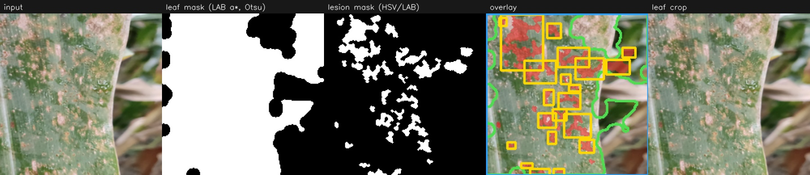

# Plantify

Course project: plant leaf disease recognition with a small, reproducible **lab → field** pipeline (source: PlantVillage, target: Seasonal Corn Leaf), plus a lightweight web demo.

It also includes an OpenCV leaf / lesion analysis and ONNX export for inference with OpenCV DNN.

## Project Question

Using an off-the-shelf backbone (ResNet-18) and simple training recipes, **how much robustness under lab→field domain shift can we gain** by doing PlantVillage **self-supervised (SimCLR)** pretraining before fine-tuning on a small labeled corn field dataset?

We report results honestly for:

- **Full-data** target fine-tuning
- **Few-shot** target fine-tuning (10 labeled images/class)

## Tech Stack

- **Python**: 3.12
- **Deep learning**: PyTorch + torchvision (ResNet-18)
- **Self-supervised learning**: SimCLR (contrastive pretraining on PlantVillage)
- **Explainability**: Grad-CAM (`grad-cam`)
- **Computer vision**: OpenCV (segmentation, ONNX inference via the DNN module)
- **Web demo**: Flask + simple HTML/CSS
- **Logging**: TensorBoard

## Results (Seasonal Corn Leaf, 5 classes)

Key findings:

- **Full data**: ImageNet transfer is strongest overall.
- **Few-shot**: PlantVillage SSL pretraining becomes much more valuable — protecting pretrained features early via backbone freezing and a lower learning rate is critical.
- **B3 (PV Supervised) underperforms in few-shot**: a shallow 5-epoch supervised backbone appears to overfit to lab-domain PlantVillage patterns and does not transfer as robustly as SSL features under label scarcity.

| Baseline | Full Data | 10-shot |
|---|---:|---:|
| B1 — Scratch | 92.31% | 29.86% |
| B2 — ImageNet | 96.61% | 61.76% |
| B3 — PV Supervised | 95.48% | 39.82% |
| B4 — SSL (ours) | **95.48%** | **70.14%** |

*All accuracies on the same held-out test split (442 images, 15% of Seasonal Corn Leaf dataset).  
Full data = 2060 training images. 10-shot = 10 labeled images per class (50 total).*

## Setup

```bash
python3 -m venv venv
./venv/bin/pip install -r requirements.txt
```

PlantVillage is expected at `PlantVillage-Dataset/raw/color/` (ImageFolder: one folder per class).

Put the **Seasonal Corn Leaf** dataset under `data/corn_leaf/` in the same ImageFolder layout (or change `paths.target_root` in `configs/finetune.yaml`).

## 1) Supervised Baseline on PlantVillage

```bash
./venv/bin/python -m src.train_supervised --config configs/config.yaml
```

TensorBoard:

```bash
./venv/bin/tensorboard --logdir runs
```

## 2) SimCLR (Self-Supervised) Pretraining on PlantVillage

Trains only the encoder; saves `encoder_state` for later fine-tuning.

```bash
./venv/bin/python -m src.train_simclr --config configs/simclr.yaml --run_name simclr_pv
```

Checkpoints: `checkpoints/simclr_pv_best.pt` (and `_last.pt`).

## 3) Fine-Tune on the Target (Corn) Dataset

Edit `configs/finetune.yaml`:

- `finetune.init`: `imagenet` | `scratch` | `ssl` | `supervised_pv`
- `paths.pretrained_path`: checkpoint from step 1 or 2 when needed
- `data.fewshot_per_class`: integer (e.g. `10`) or `null` for full training split

```bash
./venv/bin/python -m src.train_finetune --config configs/finetune.yaml --run_name corn_ft_ssl
```

## 4) Evaluate + Grad-CAM

Point `--data_root` at a folder of class subfolders.

> **Note:** `src.evaluate` evaluates on whatever folder you point it at. If you point it at the entire dataset folder it is **not** the held-out test split used during training. For official accuracy numbers, use the test accuracy printed at the end of `train_finetune`.

```bash
./venv/bin/python -m src.evaluate \
  --ckpt checkpoints/corn_ft_ssl_best.pt \
  --data_root data/corn_leaf \
  --gradcam_image path/to/one_leaf.jpg \
  --gradcam_out runs/cam.png
```

## 5) Web Demo

Point `PLANTIFY_CKPT` at your best **classification** checkpoint (supervised or fine-tuned — not a raw SimCLR encoder checkpoint).

```bash
export PLANTIFY_CKPT="$(pwd)/checkpoints/corn_ft_ssl_best.pt"
./venv/bin/python webapp/app.py
```

Open `http://127.0.0.1:5000`.

## 6) OpenCV Leaf & Lesion Analysis

A rule-based pass next to the CNN: LAB + Otsu thresholding finds the leaf, morphology cleans the mask, and HSV/LAB colour rules mark lesion-like regions with bounding boxes. It's also shown in the web demo.

```bash
./venv/bin/python -m src.cv_preprocess path/to/leaf.jpg
```



## 7) ONNX Export + OpenCV DNN

```bash
./venv/bin/python -m src.export_onnx --ckpt checkpoints/b2_imagenet_full_best.pt
./venv/bin/python -m src.infer_opencv --model exports/b2_imagenet_full.onnx path/to/leaf.jpg
```

The export script checks the ONNX model against PyTorch; on 100 corn images, OpenCV DNN gave the same predictions.

## 8) C++ Inference (learning experiment)

A small C++ program (`cpp/infer.cpp`) that runs the same ONNX model with OpenCV C++. I added it to start learning OpenCV's C++ API; it mirrors `src/infer_opencv.py`.

```bash
cmake -S cpp -B cpp/build && cmake --build cpp/build
./cpp/build/plantify_infer exports/b2_imagenet_full.onnx path/to/leaf.jpg
```

## Plots per Checkpoint

Confusion matrix + per-class metrics:

```bash
./venv/bin/python -m src.plot_metrics \
  --ckpt checkpoints/b2_imagenet_full_best.pt \
  --data_root data/corn_leaf \
  --out_dir assets/plots/b2_full
```

## Baseline Comparison Plot

Edit `results/results.yaml` with your final numbers, then:

```bash
./venv/bin/python -m src.plot_baselines --results results/results.yaml --out_dir assets/plots
```

This writes `assets/plots/baseline_comparison.png` (accuracy + error rate for full-data vs 10-shot).

## Notes

- **Quality vs speed**: for better results, upgrade `image_size` to **224** in configs (training is slower but features are richer).
- **Checkpoints** from `train_supervised` / `train_finetune` contain `model_state` + `class_names` for inference.
- **SimCLR checkpoints** contain `encoder_state` only — not directly usable for classification without a fine-tuning head.
- **OpenCV analysis is a heuristic**: it can box soil between leaves and miss pale grey lesions.
- **Limitations**: experiments were constrained by laptop compute and time. SimCLR was trained for 5 epochs (sufficient for a course-level system study; a production SSL pipeline would use 100–200 epochs with a larger batch size).

---

## Datasets

| Dataset | Description | Source |
|---|---|---|
| **PlantVillage** | 54,305 lab-condition leaf images across 38 disease classes; used as source domain for supervised pretraining (B3) and SSL pretraining (B4) | [Innovatiana / PlantVillage](https://www.innovatiana.com/en/datasets/plantvillage) |
| **Seasonal Corn Leaf Disease** | Multi-year field-condition corn leaf images across 5 disease classes; used as the target domain for all fine-tuning and evaluation | Mendeley Data, V1 — DOI: [10.17632/vy629dngm8.1](https://doi.org/10.17632/vy629dngm8.1) |

## Citation

If you use this project or build on its results, please cite the original datasets:

**Seasonal Corn Leaf Disease Dataset**
Ahmad, MD Hasan (2025). Seasonal Corn Leaf Disease Dataset: A Multi-Year Collection
for Robust Analysis. Mendeley Data, V1.
https://doi.org/10.17632/vy629dngm8.1


**PlantVillage Dataset**
Hughes, D., Salathé, M. (2015). An open access repository of images on plant health
to enable the development of mobile disease diagnostics.
https://www.innovatiana.com/en/datasets/plantvillage


## Acknowledgements

- Pretrained ImageNet weights loaded via [torchvision](https://pytorch.org/vision/stable/)
- Grad-CAM visualisations via [pytorch-grad-cam](https://github.com/jacobgil/pytorch-grad-cam)
- SSL pretraining follows the [SimCLR framework](https://arxiv.org/abs/2002.05709) — Chen et al., *A Simple Framework for Contrastive Learning of Visual Representations*, ICML 2020